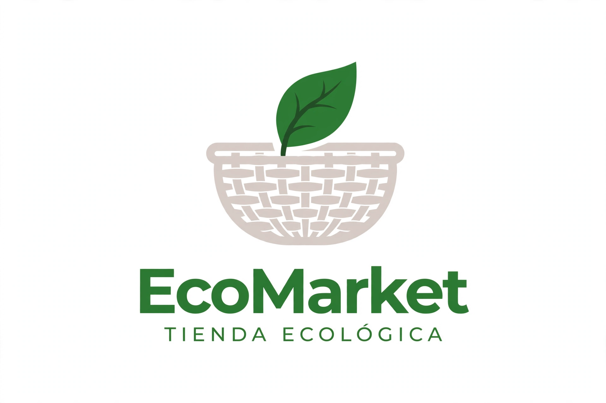
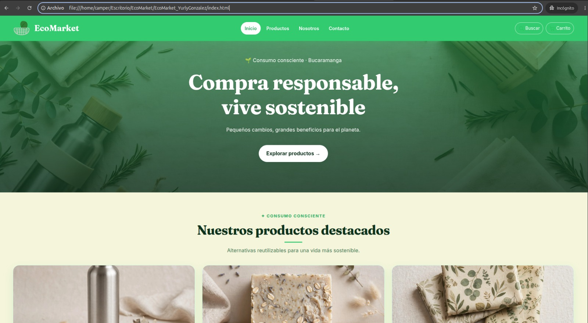
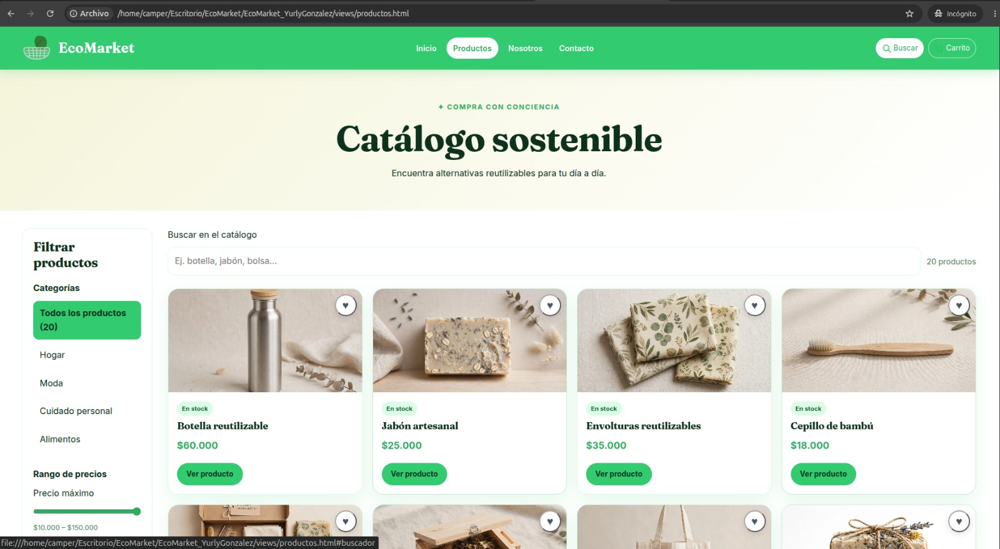
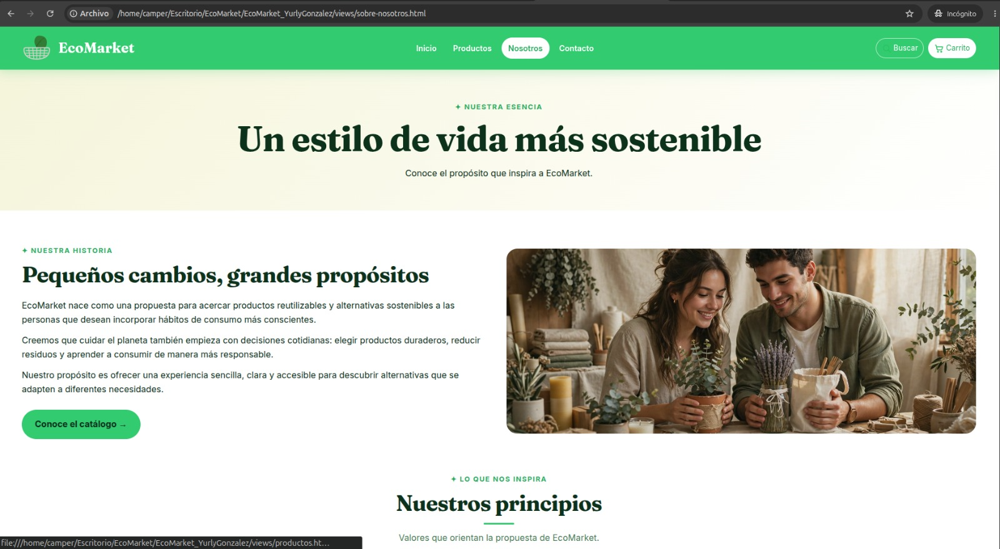
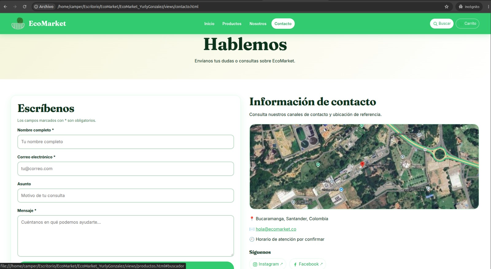

<div align="center">
  
  <h1>EcoMarket - Yurly Gonzalez</h1>
</div>

# 🌿 EcoMarket — Tienda de Productos Ecológicos

## 1. Descripción del proyecto

EcoMarket es una tienda virtual desarrollada con HTML5 y CSS3 para presentar productos ecológicos, reutilizables y sustentables.

El proyecto busca promover el consumo consciente mediante una interfaz clara, organizada y adaptable a diferentes dispositivos. Los usuarios pueden explorar el catálogo, conocer la historia de la tienda y consultar los medios de contacto.

## 2. Objetivos

- Promover el uso de productos reutilizables y ecológicos.
- Presentar un catálogo organizado de productos.
- Ofrecer una experiencia de navegación sencilla y agradable.
- Implementar un diseño responsive para computadores, tabletas y celulares.
- Aplicar los conocimientos de HTML5, CSS3 y control de versiones con Git y GitHub.

## 3. Identidad visual

La identidad visual de EcoMarket utiliza colores asociados con la naturaleza, la sostenibilidad y la limpieza visual.

| Elemento | Color |
|---|---|
| Verde principal | `#22c55e` |
| Verde oscuro | `#15803d` |
| Verde profundo | `#052e16` |
| Verde claro | `#bbf7d0` |
| Fondo principal | `#ffffff` |
| Fondo suave | `#f0fdf4` |

**Tipografías:** Fraunces e Inter, integradas mediante Google Fonts.

**Estilo:** diseño limpio, espacios organizados, tarjetas de productos, navegación sencilla y colores inspirados en la naturaleza.

## 4. Tecnologías utilizadas

- **HTML5:** estructura semántica y contenido de las páginas.
- **CSS3:** estilos, distribución, diseño responsive, animaciones e interacciones visuales.
- **Flexbox y CSS Grid:** organización de los elementos.
- **Media queries:** adaptación a diferentes tamaños de pantalla.
- **Pseudo-clases CSS:** estados visuales e interacciones.
- **Git y GitHub:** control de versiones y almacenamiento del repositorio.
- **Google Fonts:** integración de tipografías.

El proyecto no utiliza JavaScript ni frameworks. Los estilos se encuentran organizados en cuatro archivos CSS separados. No se utiliza `@import` para cargar las fuentes.

## 5. Estructura del proyecto

```text
EcoMarket_YurlyGonzalez/
│
├── index.html
├── README.md
│
├── css/
│   ├── main.css
│   ├── layout.css
│   ├── components.css
│   └── animations.css
│
├── views/
│   ├── productos.html
│   ├── sobre-nosotros.html
│   └── contacto.html
│
├── img/
│   ├── logo/
│   │   └── logo.png
│   │
│   ├── icons/
│   │   ├── logo-ecomarket.svg
│   │   ├── icono-busqueda.svg
│   │   ├── icono-carrito.svg
│   │   ├── icono-instagram.svg
│   │   └── icono-facebook.svg
│   │
│   ├── products/
│   ├── hero/
│   └── testimonials/
│
└── capturas/
```

Las carpetas de imágenes contienen los recursos visuales utilizados por las páginas. La carpeta `capturas/` se utiliza para documentar el funcionamiento del sitio.

## 6. Páginas del sitio web

### Inicio — `index.html`

Página principal que presenta la tienda, sus productos destacados y los accesos a las demás secciones.

**Captura de pantalla:**



### Productos — `views/productos.html`

Catálogo con 20 productos ecológicos, tarjetas de productos, precios, imágenes y controles visuales de filtrado.

**Captura de pantalla:**



### Sobre nosotros — `views/sobre-nosotros.html`

Página informativa que presenta la historia, los valores y el propósito de EcoMarket.

**Captura de pantalla:**



### Contacto — `views/contacto.html`

Página con formulario de contacto, validaciones HTML/CSS, información de contacto y mapa integrado.

**Captura de pantalla:**



## 7. Características principales

- Navegación entre las cuatro páginas del sitio.
- Encabezado fijo durante el desplazamiento.
- Catálogo de productos con tarjetas organizadas.
- Diseño adaptable a computadores, tabletas y celulares.
- Filtros visuales mediante controles CSS.
- Efectos visuales en las tarjetas y elementos interactivos.
- Validación visual de campos del formulario.
- Sección de testimonios con desplazamiento.
- Marquesina animada en la parte inferior.
- Preferencia de movimiento reducido mediante CSS.
- Integración de mapa en la página de contacto.
- Uso de imágenes e iconos organizados en carpetas.

## 8. Diseño responsive

El sitio utiliza CSS Grid, Flexbox y media queries para adaptar su distribución según el tamaño de la pantalla.

La cuadrícula del catálogo contempla:

- **Escritorio:** cuatro columnas.
- **Tableta:** dos columnas.
- **Celular:** una columna.

Se debe comprobar la visualización en pantallas pequeñas, especialmente a un ancho de 360 píxeles, para evitar desbordamientos horizontales.

**Evidencias responsive:**

- Escritorio: `capturas/09-responsive-escritorio.png`
- Tableta: `capturas/08-responsive-tableta.png`
- Celular: `capturas/07-responsive-movil.png`

## 9. Interacciones y limitaciones

Las interacciones visuales se implementan exclusivamente con HTML y CSS.

- Los filtros utilizan controles de formulario y selectores CSS.
- Los corazones de favoritos utilizan estados visuales mediante pseudo-clases CSS.
- Los campos del formulario emplean validación HTML y estilos CSS.
- Los testimonios utilizan desplazamiento con `scroll-snap`.
- Las animaciones incluyen una alternativa para usuarios que prefieren movimiento reducido.

**Limitaciones:** al no utilizar JavaScript ni un backend, el proyecto no implementa procesamiento real de pedidos, almacenamiento permanente de favoritos, búsqueda dinámica, pagos ni envío de mensajes a un servidor. Los controles visuales no deben interpretarse como funciones de compra completas.

## 10. Organización del código CSS

Los estilos se distribuyen en cuatro archivos:

| Archivo | Función |
|---|---|
| `main.css` | Variables, colores, tipografías y estilos globales. |
| `layout.css` | Contenedores, encabezado, secciones y distribución responsive. |
| `components.css` | Navegación, tarjetas, formularios, filtros y otros componentes. |
| `animations.css` | Animaciones, transiciones y efectos visuales. |

Esta separación facilita el mantenimiento y la organización del código.

## 11. Instalación y ejecución

1. Clonar o descargar el repositorio.
2. Abrir la carpeta del proyecto en Visual Studio Code.
3. Verificar que las carpetas `css/`, `views/` e `img/` conserven su estructura.
4. Abrir `index.html` en un navegador.
5. Navegar por las diferentes páginas y comprobar los enlaces, imágenes y estilos.

No se requiere instalar dependencias ni ejecutar un servidor para visualizar la versión estática localmente.

## 12. Evidencias del proyecto

Las siguientes capturas se agregarán a la carpeta `capturas/`:

| Archivo | Evidencia |
|---|---|
| `01-inicio-escritorio.png` | Página de inicio en computador. |
| `02-inicio-movil.png` | Página de inicio en celular. |
| `03-pagina-principal.png` | Sección principal o presentación. |
| `04-catalogo-productos.png` | Catálogo completo. |
| `05-sobre-nosotros.png` | Página sobre nosotros. |
| `06-contacto.png` | Página de contacto. |
| `07-responsive-movil.png` | Diseño responsive en celular. |
| `08-responsive-tableta.png` | Diseño responsive en tableta. |
| `09-responsive-escritorio.png` | Diseño responsive en escritorio. |
| `10-catalogo-movil.png` | Catálogo en celular. |
| `11-formulario-contacto.png` | Formulario y validación visual. |
| `12-efectos-css.png` | Animaciones y efectos CSS. |
| `13-estructura-proyecto.png` | Estructura de carpetas en Visual Studio Code. |
| `14-sitio-publicado.png` | Sitio web publicado. |
| `15-git-ramas-commits.png` | Ramas y commits de Git. |

Las capturas se incorporarán a medida que se complete la documentación y publicación del proyecto.

## 13. Control de versiones y repositorio

El proyecto se gestiona mediante Git y GitHub, utilizando ramas para organizar el desarrollo de las diferentes secciones.

**Repositorio público:**

https://github.com/ingyurlygonzalezdulcey-creator/EcoMarket_YurlyGonzalez

Ramas de trabajo utilizadas:

- `main`
- `develop`
- `feature/inicio`
- `feature/catalogo`
- `feature/nosotros`
- `feature/contactos`
- `feature/estilos`
- `feature/readme`

La evidencia del historial de cambios y las ramas se incluirá en `capturas/15-git-ramas-commits.png`.

## 14. Publicación del proyecto

**Enlace del sitio publicado:**

[Pendiente de agregar el enlace definitivo de GitHub Pages u otra plataforma de publicación.]

Una vez publicado el sitio, se reemplazará este texto por la URL real y se agregará una captura de la página funcionando.

## 15. Autoría

**Proyecto:** EcoMarket — Tienda de Productos Ecológicos.

**Repositorio:** EcoMarket_YurlyGonzalez.

**Propósito:** proyecto académico de desarrollo web enfocado en HTML5, CSS3, diseño responsive y control de versiones.


